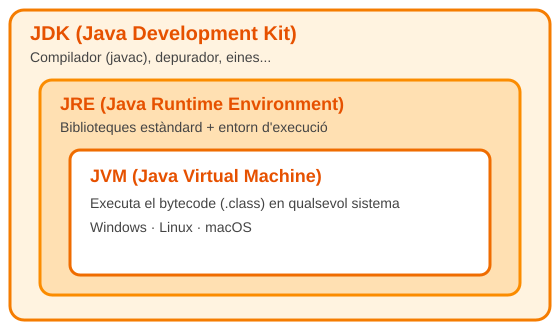

# Què és Java?

**Java** és un llenguatge de programació **orientat a objectes**, creat per *Sun Microsystems* (actualment propietat d'Oracle) i llançat l'any **1995**.

## Característiques principals

- *Orientat a objectes*: tot s'organitza en classes i objectes.
- *Multiplataforma*: el codi es compila a **bytecode**, que s'executa en la JVM.
- *Fortament tipat*: cal declarar el tipus de cada variable.
- ~~Gestió manual de memòria~~: el *garbage collector* s'ocupa d'alliberar-la.

## Com funciona?

El codi font (`.java`) es **compila** a bytecode (`.class`) i després la **JVM** l'executa.

| Component | Significat | Per a què serveix |
|-----------|-----------|-------------------|
| **JDK** | Java Development Kit | Desenvolupar (inclou el compilador `javac`) |
| **JRE** | Java Runtime Environment | Executar aplicacions Java |
| **JVM** | Java Virtual Machine | Executar el bytecode |

!!! note "Nota"
    Si només vols **executar** programes, tens prou amb el JRE. Per a **programar** necessites el JDK.

!!! quote "Lema de Java"
    *Write once, run anywhere* (escriu una vegada, executa-ho en qualsevol lloc).

??? question "Java i JavaScript són el mateix?"
    **No.** Són llenguatges completament diferents. El nom només s'assembla per motius de màrqueting de l'època.
